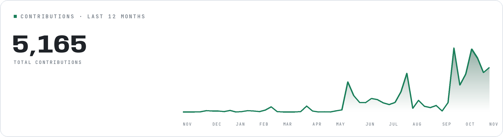

  <a href="https://blog.gyanano.com">
    <picture>
      <source media="(prefers-color-scheme: dark)" srcset="https://raw.githubusercontent.com/Gyanano/Gyanano/main/assets/banner-dark.png" />
      
    </picture>
  </a>

  <a href="https://blog.gyanano.com">Blog</a>

## About

I build embedded systems by day — C, RTOS, STM32, ESP32 — and full-stack apps and desktop tools the rest of the time. Most of my recent projects are about AI agents.

I keep asking the same question from the bottom up: how does a system actually run, from an electron through a transistor to a pixel on a screen?

I like minimal code: clear abstractions, type safety, and careful memory management.

`4+ years` `20+ projects` `INTP-A` `China`

## GitHub

  <picture>
    <source media="(prefers-color-scheme: dark)" srcset="https://raw.githubusercontent.com/Gyanano/Gyanano/main/assets/cards/bento-1-dark.png" />
    
  </picture>

  <picture>
    <source media="(prefers-color-scheme: dark)" srcset="https://raw.githubusercontent.com/Gyanano/Gyanano/main/assets/cards/bento-2-dark.png" />
    
  </picture>

  <picture>
    <source media="(prefers-color-scheme: dark)" srcset="https://raw.githubusercontent.com/Gyanano/Gyanano/main/assets/cards/bento-3-dark.png" />
    
  </picture>

---

  <a href="https://blog.gyanano.com">blog.gyanano.com</a> ·
  <a href="https://github.com/Gyanano">GitHub</a> ·
  <a href="mailto:1624055384@qq.com">1624055384@qq.com</a>

